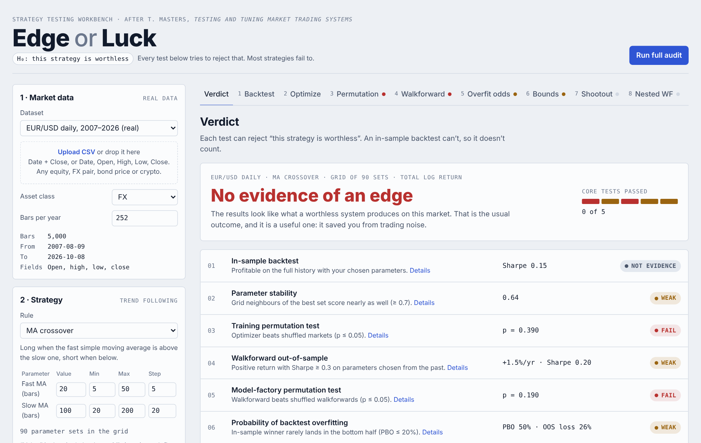
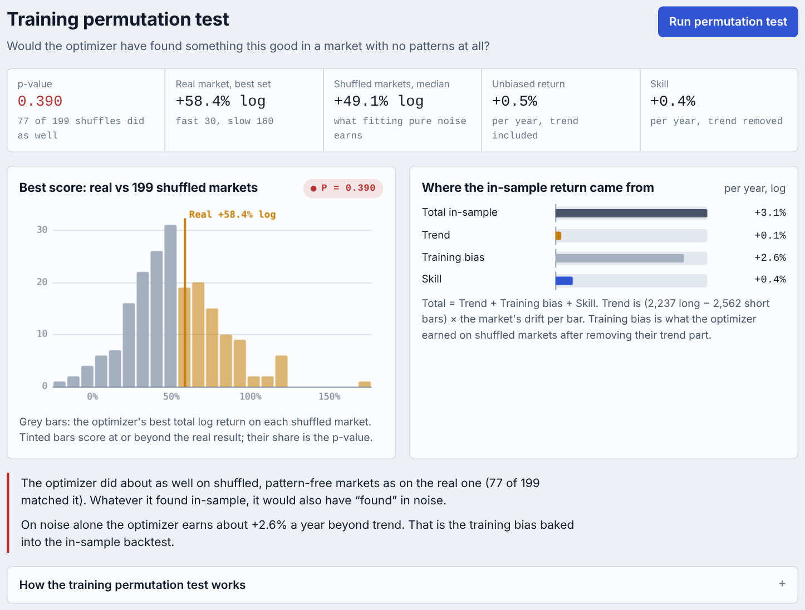
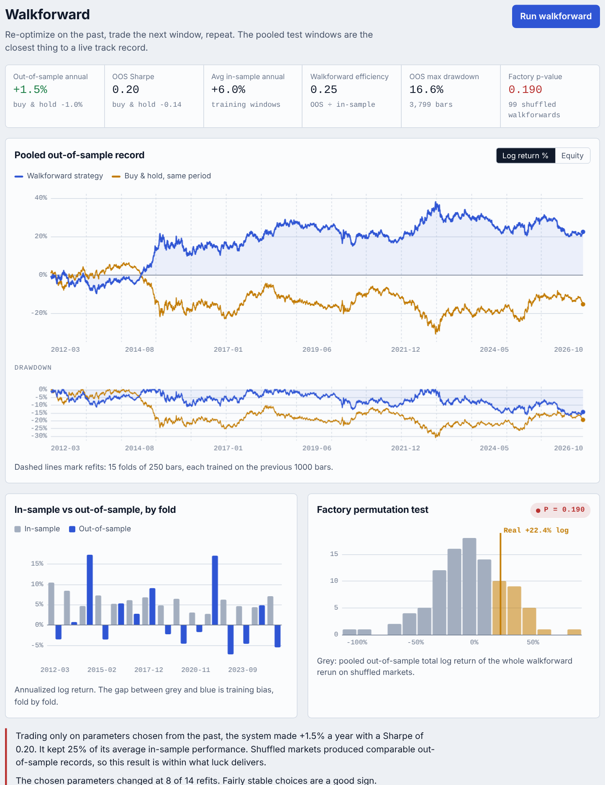
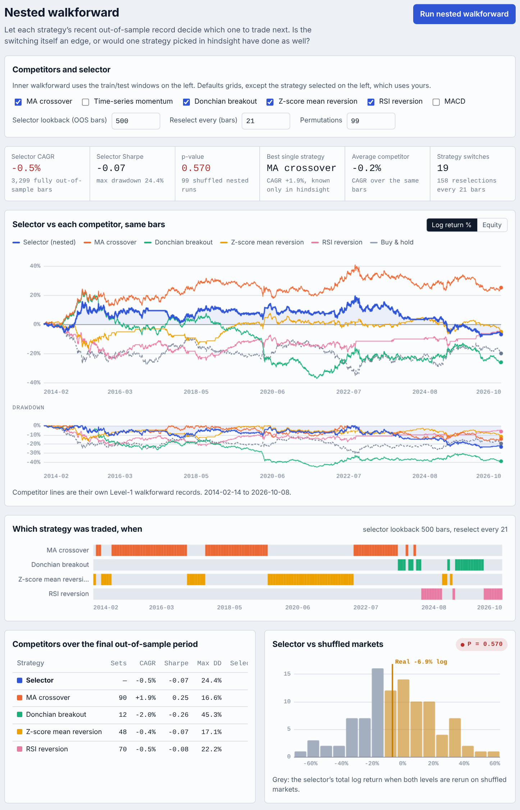
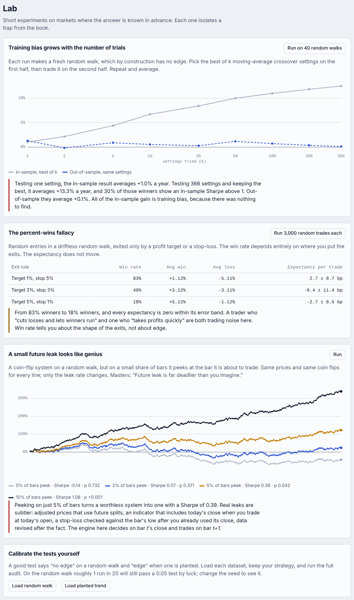

# Edge or Luck

**Does a trading strategy have an edge, or did the backtest just fit noise?**

Edge or Luck is a browser-based workbench for testing simple trading strategies on any price history: equities, FX, bonds or crypto. It runs the out-of-sample and statistical tests from Timothy Masters' *Testing and Tuning Market Trading Systems* and returns a verdict against the null hypothesis that the strategy is worthless. It is also built to teach: each test explains what it measures, how to read the result, and which trap it guards against.

**[Live demo →](https://solven139.github.io/edge-or-luck/)**



## Why

An in-sample backtest almost always looks good. Parameters chosen on a history fit that history's noise as well as any real pattern, and the noise does not repeat. Choosing the best of several strategies adds another layer of optimism (selection bias). This app measures both, using only methods that make no assumptions about the shape of returns.

## What you can do

- **Load data.** Upload a CSV (date + close, or full OHLC) or use the bundled samples: EUR/USD daily 2007–2026, BTC/USD daily 2015–2026, a pure random walk (no edge by construction) and a planted trend (a real edge exists).
- **Pick a rule.** MA crossover, time-series momentum, Donchian breakout, z-score mean reversion, RSI reversion or MACD. Each parameter has a value for a single backtest and a min/max/step range for the optimizer.
- **Set positions and risk.** Long and short, long only or short only. Fill at the next bar's open or the signal bar's close. Optional stop-loss, take-profit and maximum holding period, a cost per side, and starting capital.
- **Run the full audit**, or each test on its own.

## The tests

| Tab | What it answers | Method | Masters |
|---|---|---|---|
| Backtest | What would these parameters have done? (in-sample, not evidence) | Single-bar marked-to-market log returns; full performance report | ch. 1, 5 |
| Optimize | How special is the best parameter set, and is it a plateau or a spike? | Grid search, distribution of every set, heatmap, sensitivity curves | ch. 4 |
| Permutation | Would the optimizer find something this good in a market with no patterns? | Monte Carlo permutation test of the training process; return split into trend, skill and training bias | ch. 7 |
| Walkforward | How does the strategy-plus-optimizer do on data it never saw? | Rolling or anchored walkforward; permutation test of the whole model factory | ch. 5, 7 |
| Overfit odds | How often does the in-sample winner land in the bottom half out-of-sample? | Combinatorially symmetric cross validation (probability of backtest overfitting) | ch. 5 |
| Bounds | How low could the true mean return be? How deep could next year's drawdown go? | BCa bootstrap; profit factor bound; double-bootstrap drawdown bound | ch. 6 |
| Shootout | Does the best of several strategies survive the fact that you picked it? | Solo vs selection-adjusted permutation p-values | ch. 5, 7 |
| Nested WF | Can recent out-of-sample performance pick which strategy to trade next? | Two-level walkforward with a three-segment permutation test | ch. 5, 7 |
| Lab | — | Experiments on random walks: training bias vs number of trials, the percent-wins fallacy, future leak | ch. 1, 5 |

Every report includes cumulative P&L, CAGR, volatility, Sharpe, Sortino and Calmar ratios, max drawdown and time under water, win rate, average gain and loss, payoff ratio, expectancy, profit factor, streaks, exposure, skewness and kurtosis, and returns by calendar year, all compared against buy and hold.

<table>
<tr><td></td><td></td></tr>
<tr><td></td><td></td></tr>
</table>

## How it works

- **Engine** (`src/engine.js`): pure JavaScript with no dependencies, run in a Web Worker so long permutation runs never block the page. Prices are handled as log prices and returns as log differences. Decisions are made at a bar's close using data up to that close; fills happen at the next open (or the same close), and every bar is marked to market.
- **Bar permutation** follows Masters: close-to-open gaps and open-to-high/low/close moves are shuffled as separate series, the first decision bar is held fixed, and the final close is preserved, so every permuted market has the same trend and the same distribution of moves.
- **Performance**: indicators are cached per market, and every parameter set's bar returns are stored in one aligned matrix, so walkforward folds, CSCV splits and permutations are cheap lookups. A full audit of a 5,000-bar series (90 parameter sets, 199 + 99 permutations) runs in about 6 seconds in the browser.
- **UI** (`src/ui.js`, `src/csv.js`): vanilla JS with hand-drawn canvas charts, light and dark themes, and a phone layout.
- **Build** (`scripts/build.mjs`): inlines everything into one self-contained `index.html`.

## Validation

`npm test` runs 19 tests (about 7 seconds):

- **No look-ahead.** Changing prices after bar *t* never changes any signal or any return up to *t*, for every strategy, both fill modes, and with stops, targets and time exits active.
- **Accounting.** Bar-by-bar returns add up exactly to trade returns.
- **Permutation invariants.** Basis bars and final close are fixed; every permuted bar is valid OHLC.
- **Calibration.** On random walks, training permutation p-values are roughly uniform (no excess false positives). A planted trend is detected by the training, walkforward and nested permutation tests.
- **CSV parsing.** Adjusted-close rescaling, newest-first files, semicolon and tab delimiters, day-first and month-first dates, Unix timestamps, thousands separators.

## Run locally

Requires Node 20 or later. There are no dependencies to install.

```bash
npm test          # run the test suite
npm run build     # writes dist/index.html
open dist/index.html
```

## CSV format

A header row with a date column and either a close column or open, high, low and close. Recognised names include `Date`, `Time`, `Timestamp`, `Open`, `High`, `Low`, `Close`, `Adj Close`, `Price`, `Last`. If `Adj Close` is present the bars are rescaled to it. Comma, semicolon, tab and pipe delimiters are detected automatically. At least 300 rows are required; thousands work best. Upload prices, not yields.

## Limitations

Slippage beyond a fixed cost per side, market impact, financing and carry (FX swap points, futures roll, crypto funding), short-borrow fees and position sizing are not modelled. Every trade is one unit of exposure. The tests use the whole file, so keep your most recent data out of development and test the final system on it once. Bar permutation assumes overnight gaps and intrabar moves are independent.

## References

- Timothy Masters, *Testing and Tuning Market Trading Systems: Algorithms in C++*, Apress, 2018.
- David H. Bailey, Jonathan Borwein, Marcos López de Prado and Qiji Jim Zhu, "The Probability of Backtest Overfitting", *Journal of Computational Finance*, 2017.
- Bradley Efron, "Better Bootstrap Confidence Intervals", *Journal of the American Statistical Association*, 1987.

Sample market data from [Alpha Vantage](https://www.alphavantage.co/).

## License

MIT
